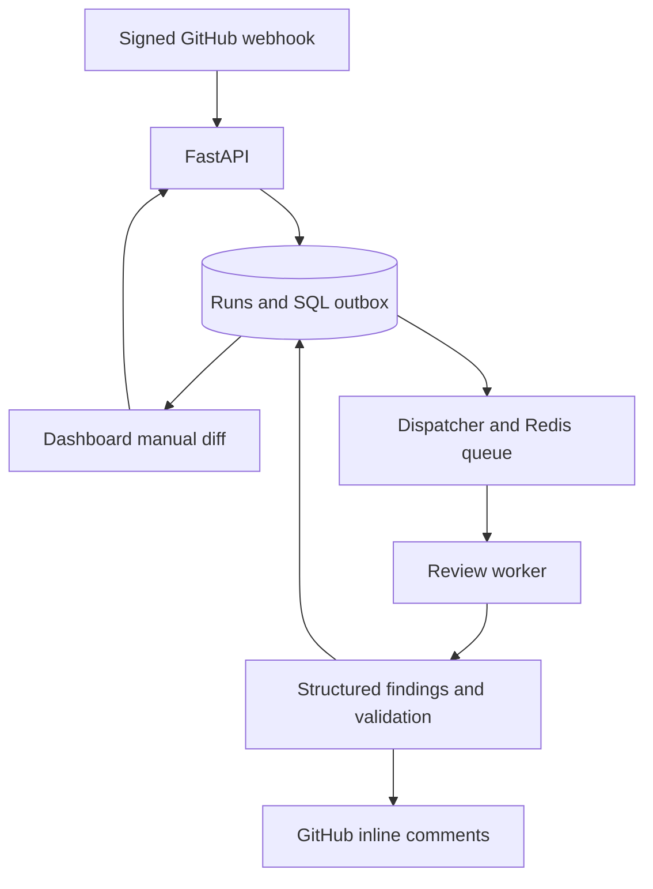

# AI Code Review Agent

A GitHub-integrated reviewer that checks pull request diffs for concrete bugs, validates
structured findings, and posts inline comments. A React dashboard shows review history,
findings, and queued manual diff reviews. An evaluation harness measures results without
pretending that a correct line number proves a correct bug report.

This is a portfolio project demonstrating a complete review pipeline: GitHub webhook →
durable SQL outbox → Redis/RQ worker → model finding validation → inline pull-request
comment → dashboard history. The repository includes a deterministic demo, a real-model
integration path, and an end-to-end GitHub App verification record.

**Status:** working portfolio MVP under active hardening. The six-case model pilot is
exploratory, not a general accuracy benchmark. Public hosting and current remote CI must
be verified separately. See [release status](docs/release-status.md).

**Live integration verified:** a fresh draft PR in the test repository was reviewed by the
installed GitHub App; the model identified an unconditional delete-permission bug, the App
posted an inline comment on the changed line, and the dashboard stored the matching review.
The test PR remains open and unmerged.

## Project at a glance

**Python · FastAPI · React · TypeScript · PostgreSQL · Redis/RQ · Docker · GitHub App**

Built to help a developer inspect a pull request: the service turns a diff into structured
bug reports with file/line references and evidence, validates their locations, and publishes
inline feedback. The dashboard makes review results and failures inspectable.

**Reviewer shortcuts:** [Architecture](docs/architecture.md) · [Five-minute demo](docs/demo.md) ·
[Evaluation](docs/evaluation.md) · [Validation and release status](docs/release-status.md)

## What it does

- Reviews changed lines using plain prompting, repository context, or context plus Ruff.
- Receives signed GitHub App webhooks, persists jobs before acknowledging, and processes
  them with Redis/RQ outside the HTTP request.
- Rechecks the PR head before publishing and uses review markers to reduce duplicates.
- Shows history, evidence, severity, and available diffs in a responsive dashboard.
- Accepts manual diffs without writing anything to GitHub; failed runs can be retried.
- Provides reproducible fixture checks and a separate human-adjudicated evaluation step.

It does not autonomously fix code, merge PRs, or guarantee bug detection. Repository
retrieval is a bounded filename heuristic, not semantic search or a caller graph.

## How a review flows



Manual reviews return findings to the dashboard; only GitHub-triggered reviews publish
comments. Before publishing, the worker checks that the PR is still open and its head
commit has not changed.

| Configuration | Input | Purpose |
| --- | --- | --- |
| Plain | Pull request diff | Establish a minimal review baseline |
| Context | Diff and bounded repository context | Supply nearby implementation details |
| Tool | Diff, context, and Ruff diagnostics | Add static analysis evidence |

Manual review supports plain or supplied context. Tool mode is part of the repository
review pipeline. These are review configurations, not three independently trained models.

## Quick start: local demo

On Windows, follow the [PowerShell acceptance walkthrough](docs/local-demo-windows.md).

Requires Docker with Compose. Copy `.env.example` to `.env`, generate a random token with
`python -c "import secrets; print(secrets.token_urlsafe(32))"`, and set it as `DASHBOARD_TOKEN`.
From a clone of this repository:

```sh
cp .env.example .env
# Edit .env and set DASHBOARD_TOKEN before starting.
docker compose up --build
```

Open **http://localhost:8000**, enter your token, select **New review → Load example → Run
review**. The review is queued and the page updates when it finishes. `REVIEW_MODE=demo`
uses a deterministic authorization fixture rule; the UI labels this output as demo data.
It is not an AI result and needs no model API key.

Compose starts the API/dashboard, dispatcher, RQ worker, PostgreSQL, and persistent Redis.
The API port is bound to localhost. PostgreSQL and Redis are not exposed to the host.
`/health` checks the HTTP process; `/ready` checks database and Redis connectivity.

## Use a real model

Set these in `.env`, then recreate the app services:

```dotenv
REVIEW_MODE=model
LLM_API_URL=https://api.groq.com/openai/v1/chat/completions
LLM_MODEL=openai/gpt-oss-20b
LLM_API_KEY=your-provider-key
```

```sh
docker compose up -d --force-recreate api worker dispatcher
```

An OpenAI-compatible Chat Completions endpoint is supported. Provider access, limits,
and charges are your responsibility. Configure both token prices for meaningful cost
estimates. Empty prices mean **unconfigured**, not free inference.

## Connect a GitHub App

1. Create an App with **Contents: read** and **Pull requests: read/write** permissions.
2. Subscribe to pull request events and install it on your test repository.
3. Host the API behind HTTPS; set the webhook URL to `/webhooks/github`.
4. Set `GITHUB_WEBHOOK_SECRET`, `GITHUB_APP_ID`, and `GITHUB_PRIVATE_KEY` in the server
   environment. PEM keys may use escaped newlines.
5. Open/update a PR, inspect the bot's inline comments, then inspect the same run in the
   dashboard. Set `REVIEW_APPROACH` to `plain`, `context`, or `tool`.

New App runs retain bounded diffs for dashboard inspection. Historical runs without saved
diffs link back to GitHub. The optional `Live AI review` Actions workflow runs independently
and does **not** populate the dashboard database. It uses trusted base-branch code and
never checks out submitted PR code.

## Development

```sh
python -m venv .venv
# Activate .venv for your shell, then:
python -m pip install -e '.[dev]'
python -m ruff check .
python -m pytest -q
cd frontend
npm ci
npm run build
npx playwright install chromium --only-shell
npm run test:e2e
```

The browser test launcher uses a disposable SQLite database, in-memory fake Redis,
real RQ SimpleWorker/dispatcher, and demo mode. It makes no GitHub/model calls. Integration tests
exercise signed webhook → SQL outbox → queue → worker → mocked GitHub comment → dashboard.
Container CI separately checks real PostgreSQL and Redis when GitHub Actions can start.

For frontend hot reload use `npm run dev`. Run FastAPI at port 8000 with environment
variables exported; Vite proxies `/api` there. Local Python does not automatically read
`.env`. Start `python -m review_agent.jobs` and `rq worker reviews --with-scheduler`
against the same database/Redis for queued work.

## Evaluation

- `smoke.json` / `dev.json` / `heldout.json`: original tiny synthetic workflow fixtures.
  Their split names do not establish a defensible held-out experiment.
- `verified-dev.json`: 12 project-authored cases with executable behavior checks: eight
  injected defects and four clean controls. Regenerate with
  `python scripts/build_verified_dataset.py`. This is **development data**.
- `pilot.json`: four adapted BugsInPy defects and two synthetic clean controls.
  [Pilot report](docs/pilot-results.md) records the existing model results and limitations.

```sh
review-agent benchmark benchmark/datasets/verified-dev.json --approach plain > results.jsonl
python -m review_agent.evaluation benchmark/datasets/verified-dev.json results.jsonl judgments.json --template
# Inspect each finding and fill reviewer, verdict, rationale, and expected_index.
python -m review_agent.evaluation benchmark/datasets/verified-dev.json results.jsonl judgments.json
```

Repeat runs for each approach with a fixed model, prompt, dataset, and `APP_GIT_SHA`.
The numerical harness uses provisional location matching; the separate adjudicator
requires recorded human judgments and binds them to dataset/prediction hashes. Failed
cases are visible; the CLI exits nonzero for incomplete runs. Never report demo/oracle
output as model performance. See [evaluation protocol](docs/evaluation.md).

## Architecture and operations

See [architecture](docs/architecture.md), [deployment](docs/deployment.md),
[security](docs/security.md), and [demo guide](docs/demo.md).

The dashboard uses a shared token, not multi-user accounts. Tokens remain in browser memory.
Source code is stored in the database and sent to the configured model provider in model
mode. Use trusted repositories, HTTPS, and restricted network access. Keep keys out of git.

Tables are created additively; this release adds `manual_review_runs` and `review_outbox`
without changing existing columns. It does not provide a general schema migration engine.
Back up existing databases before upgrades. No cloud resources are provisioned automatically.

## Engineering decisions

- **Persist before acknowledging:** the run and outbox entry share a SQL transaction,
  so a temporary queue outage does not discard an accepted review.
- **Validate before publishing:** findings must reference added lines; duplicate findings
  are filtered, and stale PR heads are checked again before comments are posted.
- **Make failures visible:** queued/running/failed states, bounded retries, and explicit
  retry controls help diagnose a run instead of hiding it behind a successful HTTP response.
- **Separate correctness from model quality:** executable fixtures verify known defects;
  human adjudication determines whether a model finding actually explains the defect.
- **Keep execution bounded:** submitted repository code is not executed, context is bounded,
  and oversized diffs are rejected or skipped explicitly.

## Validation evidence

The implementation was checked locally on 7 November 2026:

| Check | Recorded result | Scope |
| --- | --- | --- |
| Python tests | 55 passed | Backend, job lifecycle, validation, evaluation, mocked integration |
| Ruff | Passed | Python lint |
| TypeScript/Vite | Production build passed | Frontend type checking and bundle |
| Playwright | 3 passed | Authentication rejection, queued demo/history, mobile layout |
| npm audit | 0 reported vulnerabilities at validation time | Installed frontend dependency graph |
| Executable development dataset | 12 cases | 8 injected defects and 4 clean controls |

These are local results, not a green remote CI badge. Compose startup, a queued demo finding,
and history after service restart were verified locally. One real model review completed
with a finding on the same authorization example; this is not an accuracy benchmark.
GitHub Actions is blocked by an account billing issue. A fresh private test PR produced a
real-model inline comment and matching dashboard record through a temporary HTTPS tunnel;
persistent hosting remains unverified. The [evidence ledger](docs/release-status.md) tracks these gates.
The six-case pilot is exploratory; no general accuracy percentage is claimed here.

## Repository guide

| Path | Contents |
| --- | --- |
| `review_agent/core.py` | Review prompts, structured findings, diff validation |
| `review_agent/api.py` | Signed webhook intake and health endpoints |
| `review_agent/jobs.py` | Outbox dispatch, worker execution, reconciliation |
| `review_agent/github.py` | GitHub App integration and comment publication |
| `review_agent/dashboard.py` | Authenticated history, detail, manual review, retry APIs |
| `review_agent/evaluation.py` | Hash-bound human adjudication |
| `frontend/` | React dashboard and browser tests |
| `tests/` | Backend tests and executable defect fixtures |
| `benchmark/datasets/` | Development fixtures and exploratory pilot data |
| `docs/` | Architecture, deployment, evaluation, security, and demo guides |

## Resume and interview

**AI Code Review Agent — Python, FastAPI, React, PostgreSQL, Redis, Docker**

- Built a GitHub-integrated LLM code review service with signed webhooks, structured
  findings, changed-line validation, and inline pull request comments.
- Developed a React/TypeScript dashboard for review history and queued manual reviews,
  backed by a SQL outbox, Redis/RQ workers, failure recovery, and retry controls.
- Added 55 backend tests, 3 browser checks, and an evaluation workflow with executable
  defect fixtures and hash-bound human adjudication across three review configurations.

Use these implementation claims for a portfolio project you can explain and demonstrate.
Do not describe it as production-deployed or add accuracy/user-impact figures without
supporting evidence. The [demo guide](docs/demo.md) provides a walkthrough. The repositories
are private, so a resume link alone will not give a recruiter access; arrange a private
walkthrough or publish a reviewed, sanitized version separately.
