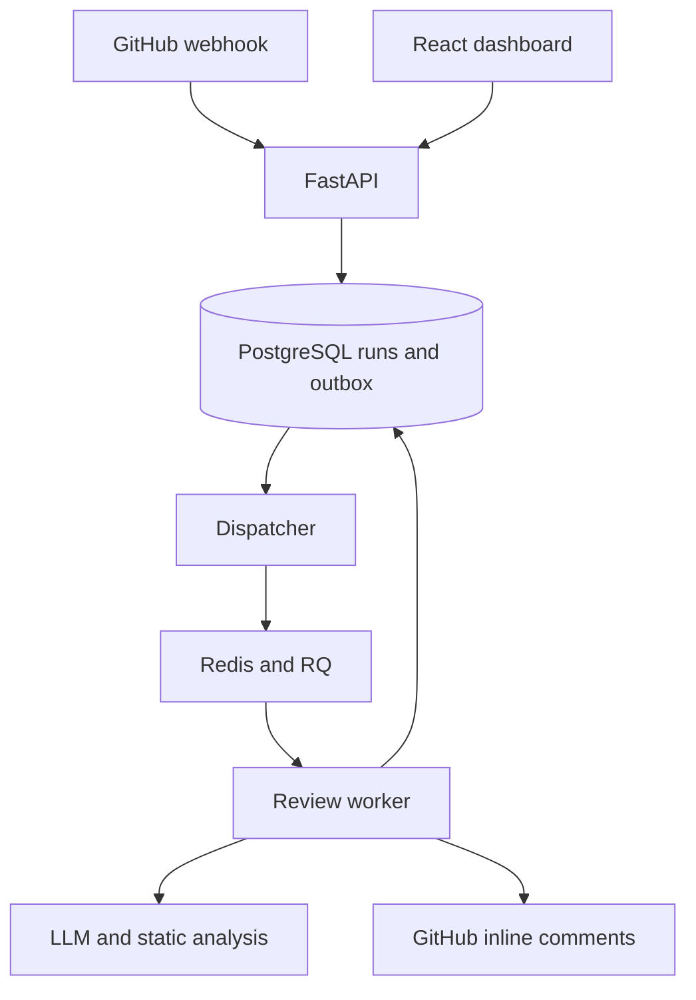

# Architecture

## Reliability boundaries

The API commits a review and an outbox record in one database transaction before returning
202. The dispatcher retries delivery while Redis is unavailable. Stable job IDs recover a
crash after enqueue but before SQL acknowledgement. RQ retries failures twice, with 60/180
second intervals. Per-run Redis locks serialize duplicate deliveries; completed runs are
not reprocessed. A 300-second job timeout bounds each attempt.

This is at-least-once processing, not a distributed exactly-once guarantee. The remote
GitHub POST and local SQL commit are not atomic. Markers reduce duplication after uncertain
publication, but the GitHub visibility/crash window remains. A Redis lock expires after
330 seconds; do not increase job timeout without increasing this lease.

The dispatcher reconciles terminal lost/failed RQ jobs to visible failed runs. Retry is an
explicit dashboard operation for failed runs. Persistent Redis AOF and PostgreSQL volumes
protect normal restarts; the SQL outbox preserves jobs not yet dispatched.

## Review approaches

All approaches share the output schema and added-line validator. `plain` sees the diff.
`context` also sees bounded changed/related files. `tool` adds Ruff diagnostics. Context mode
no longer runs Ruff unnecessarily. No submitted code is imported or executed by the app.
Oversized diffs are explicitly skipped/rejected, rather than silently truncated.

## Storage

`review_runs` and `findings` store GitHub results. New GitHub run metadata includes the
bounded diff. `manual_review_runs` stores manual diff/context/results. `review_outbox` tracks
queue delivery. Dashboard list responses omit source/finding text; detail requires the
same authenticated token. There is no automatic retention deletion yet.

## Evaluation

Location matching is a diagnostic metric. Human adjudication separately matches a finding's
meaning to a labeled defect, with rationale and hashes. Multiple findings for one bug cannot
inflate true positives. Verified development fixtures prove the labeled behavior locally;
they do not independently measure a model's generalization.
